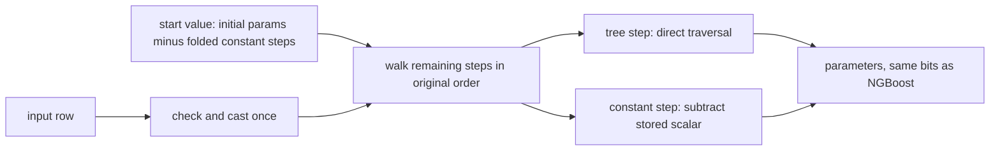
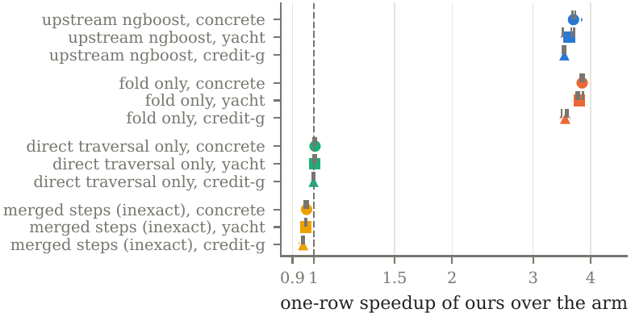
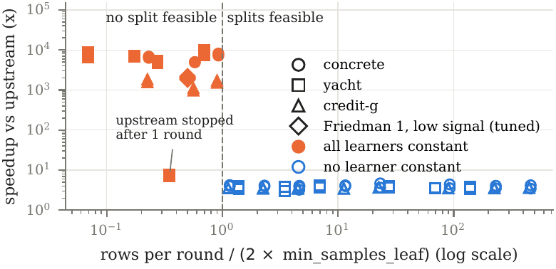
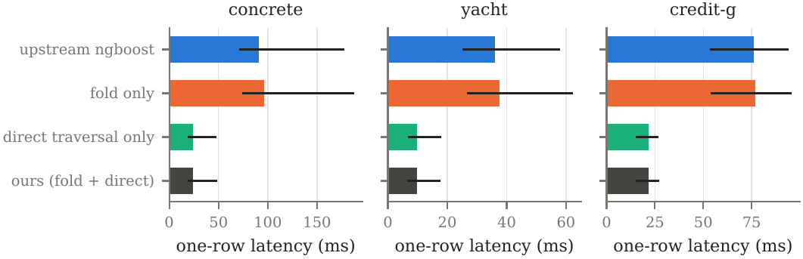

# ngbfast: bit-identical, faster prediction for NGBoost

<p align="center">
  <a href="https://x.com/tr4m0ryp"></a>
  <a href="paper/ngbfast.pdf"></a>
</p>

**ngbfast makes one-row NGBoost prediction 3.5x to 3.7x faster on tuned models with the exact same
output bits (6,994 of 6,994 test rows, 90 fitted models), by checking the input once per call instead
of once per tree. It also warns you at fit time when every tree is constant, a model that ignores its
input; only in that degenerate case does folding the constant trees make prediction 960x to 10,000x
faster.**

```bash
pip install git+https://github.com/tr4m0ryp/ngbfast
```

```python
import ngbfast
from ngboost import NGBRegressor

model = NGBRegressor().fit(X_train, y_train)
ngbfast.fold(model)                            # build the plan once, stored as model.fold_
theta = ngbfast.pred_param(model, X_test)      # same float64 bits as model.pred_param(X_test)
print(ngbfast.diagnose(model, n_train=len(X_train)))  # constant-learner share and the split bound
```

<details>
<summary>How the model works, in plain words</summary>

**The analogy.** Think of a recipe that a cook improves 500 times. Each time, they write a small
correction on a sticky note: "a bit more salt if the tomatoes are sour", "less heat if the pan is
thin". To cook the dish you start from the base recipe and apply every note in order. Some notes
say the same thing whatever the ingredients are: "add one pinch of salt". You could add those pinches
up in advance. You cannot reorder or merge them carelessly, though, because the cook rounds every
measurement, and rounding in a different order gives a slightly different dish.

**What NGBoost is.** NGBoost is gradient boosting that predicts a whole probability distribution
instead of one number. For a regression it predicts a mean and a spread; for a yes/no question, a
probability. It does this by fitting a small decision tree per distribution parameter, round after
round, each tree nudging the parameters in the direction that makes the observed data more likely.
The direction is the natural gradient: the ordinary gradient rescaled so that a step means the same
amount of change in the distribution, whatever the parameterisation.

**How it predicts.** To predict for one row, NGBoost starts from fixed initial parameters and then,
for every round and every parameter, asks that round's tree for its value and subtracts it (scaled
by the learning rate and a per-round step size). With 500 rounds and 2 parameters that is 1,000
calls into scikit-learn.

**Where the time goes.** Each of those calls re-checks the input: is it an array, does it have the
right number of columns, are there NaNs, cast it to float32. For one row this check costs more than
walking the tree. ngbfast checks and casts the input once per call, then walks every tree directly.
The walk is the same walk, on the same float32 values, so the answer is the same. This alone gives
the 3.5x to 3.7x on every tuned model we tested.

**Constant trees.** Some trees never split: they have one node and return the same number for every
input. That happens when each round's random subsample (the minibatch) is smaller than twice the
minimum leaf size, so no split is allowed. ngbfast folds these trees: it subtracts their fixed
values into a precomputed start value, in exactly the original order, and keeps any constant step
that comes after the first real tree in its place, unmerged. Floating-point arithmetic is not
associative, and merging would change the last bit. On the tuned public models no tree was constant,
so folding did nothing there.

**When every tree is constant.** Then the model predicts one fixed distribution for every input,
however much it was trained. A hyperparameter search can land there on data with little signal, and
nothing in the fit complains. ngbfast turns prediction into one broadcast (960x to 10,000x faster on
our grid) and, more usefully, raises a warning at fit time that names the bound that was violated.

**The guarantee.** The paper proves that the folded path returns the same float64 bits as NGBoost's
own loop on every row NGBoost accepts, and rejects exactly the rows NGBoost rejects. The benchmark
checks it on every test row of every fitted model.



</details>

## The method

NGBoost predicts parameter $`k`$ of the distribution as the initial value minus the scaled sum of all
trees:

```math
\theta_k(x) = \theta_{0,k} - \sum_{i=1}^{M} \big(\eta\, f_{ik}(x_{c_i})\big)\,\rho_i, \qquad k = 1,\dots,P,
```

with $`M`$ rounds, $`P`$ parameters, learning rate $`\eta`$, line-search scale $`\rho_i`$, tree
$`f_{ik}`$ and the feature columns $`c_i`$ sampled in round $`i`$. Upstream evaluates this as a
loop of $`MP`$ scikit-learn `predict` calls, each in float64 with IEEE rounding ($`\ominus`$,
$`\otimes`$):

```math
\theta_k^{(i)} = \theta_k^{(i-1)} \ominus \big((\eta \otimes f_{ik}(x_{c_i})) \otimes \rho_i\big), \qquad \theta_k^{(0)} = \theta_{0,k}.
```

**Direct traversal (the gain on typical models).** The input is validated and cast to float32 once
per call; each tree that is still called is walked with scikit-learn's low-level `tree_.predict`, the
same walk `predict` performs after its own check.

**Folding (the gain only when learners are constant).** A learner is constant when $`f_{ik}(x) = v_{ik}`$ for every accepted input (one-node
tree, all leaves equal, or a `DummyRegressor`). Its step is the scalar
$`s_{ik} = (\eta \otimes v_{ik}) \otimes \rho_i`$. With $`i^*_k`$ the first round in which column
$`k`$ has an input-dependent learner, the plan stores

```math
\text{start}_k = \big(\cdots\big((\theta_{0,k} \ominus s_{1k}) \ominus s_{2k}\big) \cdots\big) \ominus s_{i^*_k - 1,\,k}
```

and, from round $`i^*_k`$ on, the ordered list of tree steps and scalar steps, never merged. The
number of learner calls falls from $`MP`$ to the number of input-dependent learners $`N_s`$; with
$`N_s = 0`$ prediction is one broadcast. With no constant learner nothing is removed.

**Lemma 1 (bit-identical).** For every fitted model and every row upstream accepts, the folded path
returns the same float64 bits as upstream after round $`M`$, and it rejects exactly the rows
upstream rejects (each skipped learner is probed once on a zero, a NaN and an infinity row).

**Lemma 2 (when no tree can split).** If each round fits on $`m = \lfloor \phi\, n' \rfloor`$ rows
(minibatch fraction $`\phi`$, $`n'`$ training rows after any early-stopping hold-out) and

```math
m < \max(\text{min\_samples\_split},\ 2L),
```

with $`L`$ the minimum leaf size, then every learner is a one-node tree and $`\theta(x) = \text{start}`$
for every $`x`$. ngbfast turns this into a fit-time `NGBoostDegenerateWarning`. Proofs are in the
[paper](paper/ngbfast.pdf), Appendix A.

## Results

Three public data sets (concrete and yacht from UCI as Normal regressions with NGBoost's own test
masks, credit-g from OpenML as a Bernoulli classification), 3 seeded splits each, ngboost 0.5.11.
A random search (3-fold CV NLL) picks the tuned model on split 0's training rows. All arms predict
from the same fitted model. Latency: arms interleaved in rotating order, one thread, paired statistic
$`d_r = \log t^{\text{ours}}_r - \log t^{\text{arm}}_r`$, speedup $`\exp(-\bar d)`$ with $`\bar d`$
the mean over seeds of the per-seed median; SE = sd of the per-seed medians over $`\sqrt{3}`$.

**One-row prediction on tuned models, ours (fold + direct traversal) against each arm:**

| arm | concrete | yacht | credit-g |
|---|---|---|---|
| upstream ngboost 0.5.11 | **3.67x** (-1.300 ± 0.005) | **3.60x** (-1.280 ± 0.017) | **3.51x** (-1.254 ± 0.004) |
| fold only | 3.83x (-1.344 ± 0.005) | 3.78x (-1.330 ± 0.009) | 3.52x (-1.259 ± 0.010) |
| direct traversal only | 1.01x (-0.007 ± 0.005) | 1.01x (-0.005 ± 0.004) | 1.00x (0.000 ± 0.002) |
| merged steps (inexact ablation) | 0.97x (+0.035 ± 0.004) | 0.96x (+0.039 ± 0.002) | 0.95x (+0.052 ± 0.003) |
| p50 ms, upstream / ours | 91.4 / 23.8 | 36.0 / 9.7 | 70.4 / 20.3 |
| bitwise-equal rows (models) | 3,090 (30) | 904 (30) | 3,000 (30) |

Cells: speedup and paired log ratio ± SE. Below 1 the arm is faster.

**What the table says:**

- **Exactness:** fold only, direct traversal only and ours match upstream bit for bit on all 6,994
  test rows of 90 fitted models. The merged ablation does not (73 to 80 % of rows, max diff 4.0e-15).
- **Tuned models held no constant learner** (0 % on every seed of every data set, and at ngboost's
  defaults), so the tuned-model gain is direct traversal. Folding on top is a tie.
- **When every learner is constant, folding is the gain:** on the grid, 22 of 72 points were
  all-constant, exactly the points where Lemma 2's bound fails; there ours was 4,897x to 8,153x faster
  on concrete, 4,742x to 10,069x on yacht and 964x to 1,842x on credit-g (7.0x to 7.8x on the 2 yacht
  fits that upstream stopped after 1 round). These grid points fit worse, so the search never picked them.

The arms, the grid and the tuned and default runs were planned before any run. The two results below
come from follow-up settings added after the tuned models showed no constant learner (post hoc):

- **In our runs the best-score search picked an all-constant model only without usable signal:** on Friedman #1
  with the signal scaled to 0 and 0.1 of the noise, every learner was constant in 6 of 6 tuned fits,
  and one-row prediction fell from 320 to 394 ms to 0.18 ms (1,808x to 2,215x, bit-identical). Credit-g
  cut to 100 training rows did not get there (0 % constant).
- **One-SE model selection** (the simplest model within one SE of the best CV score) picked
  all-constant models at a held-out NLL tied with the best pick (credit-g n = 100: +0.020 ± 0.014 nats).

<p align="center">
  
</p>
<p align="center">
  
</p>
<p align="center">
  
</p>

## Limits

- **Folding gave no speedup on any tuned public model.** Only three data sets were run, so how often
  real tuned models are all-constant is not claimed. A model with no usable signal is better reported
  than served faster, which is why the warning is the more useful half.
- **Direct traversal is plain engineering** on scikit-learn's call path, not a new idea.
- **Smaller run than planned:** 3 data sets, 3 seeds, 3-fold search, no compiled-tree speed reference
  (Treelite, Hummingbird).
- **Plan build time:** 16 % (concrete), 18 % (yacht) and 29 % (credit-g) of fit time (median over the
  tuned and default fits) on these small sets; on the tuned models it pays for itself after 8 to 22
  one-row calls.
- **Shared host** (load 7 to 20): interleaving protects the ratios, not the absolute milliseconds.
  The 3-seed SE differs from the two-level block-bootstrap SE in the paper either way (concrete 0.005
  vs 0.013, yacht 0.017 vs 0.015); both are reported there.
- **Linear learners with zero coefficients** fold exactly only for finite inputs; opt-in, not benchmarked.

## Use

```python
import ngbfast

ngbfast.fold(model)                       # plan stored on the model
ngbfast.pred_param(model, X)              # parameters, bit-identical
ngbfast.pred_dist(model, X)               # distribution object, as model.pred_dist(X)
ngbfast.staged_pred_param(model, X)       # staged prediction keeps working
ngbfast.compare(model, X, ngbfast.pred_param(model, X))   # bitwise check against the upstream loop
ngbfast.patch()                           # opt-in: every NGBoost fit folds and predicts via the plan

from ngbfast import FastNGBRegressor      # or FastNGBClassifier, FastNGBSurvival
```

`patches/ngboost-check-input-once.patch` is an upstream-ready patch against ngboost master (commit
`662aae3`). `pred_param` checks the input once and calls the trees with `check_input=False`, folds
constant trees, and `fit` warns when every tree is constant; rounds stay stored, so staged prediction
and `partial_fit` are unchanged. Measured on one shared 8-core machine
(`patches/ngboost-check-input-once.timings.json`), it makes `pred_param` 2.1x to 2.7x faster on
default models and about 400x faster when every tree is constant, with bit-identical outputs. These
are the patch's numbers; the 3.5x to 3.7x above is ngbfast's own, measured against ngboost 0.5.11.
An earlier patch for ngboost 0.5.11 added one input check but still called every tree with its own
check, and did not speed up normal models (0.98x to 1.05x); it is replaced.
`tests/test_upstream_patch.py` applies the patch to that master commit and checks the bits; it skips
unless `NGBFAST_NGBOOST_SRC` points to an ngboost git clone holding `662aae3`.
`examples/quickstart.py` runs both regimes on synthetic data.

## Reproduce

From the repository root, with data cached outside the repository in `../_data` (override with `NGBFAST_DATA`):

```bash
pip install -e ".[test]"
pytest                                    # equivalence, truncation, bound, pickles, latency
python examples/quickstart.py

python -m bench.concrete && python -m bench.yacht --trials 20 && python -m bench.credit_g --trials 20
python -m bench.variants.small_n credit-g 100
python -m bench.variants.low_signal 0 0.1
python -m bench.variants.one_se
python -m bench.summarize                 # writes bench/results/summary.json

cd paper
python results/make_numbers.py --raw ../../_data/ngbfast_raw   # every number in the paper
python figures/make.py --raw ../../_data/ngbfast_raw
pdflatex main.tex && bibtex main && pdflatex main.tex && pdflatex main.tex
```

The full benchmark took 1.9 h on a shared 8-core host with `OMP_NUM_THREADS=1`.
`bench/results/SCOPE.md` lists what was cut from the plan and why.

## Cite

```bibtex
@misc{ouallaf2026ngbfast,
  title  = {Bit-identical, faster {NGBoost} prediction, and a warning when every tree is constant},
  author = {Ouallaf, Moussa},
  year   = {2026},
  howpublished = {\url{https://github.com/tr4m0ryp/ngbfast}},
  note   = {Paper: paper/ngbfast.pdf}
}
```

## License

Apache License 2.0. ngbfast extends [NGBoost](https://github.com/stanfordmlgroup/ngboost)
(Apache-2.0, Stanford ML Group): `ngbfast/reference.py` reproduces NGBoost's prediction loop and
`patches/` modifies NGBoost's source, so the package keeps the upstream license. See
[LICENSE](LICENSE) and [NOTICE](NOTICE). Copyright 2026 Moussa Ouallaf, Husimi.ai
(moussa@husimi.ai).
